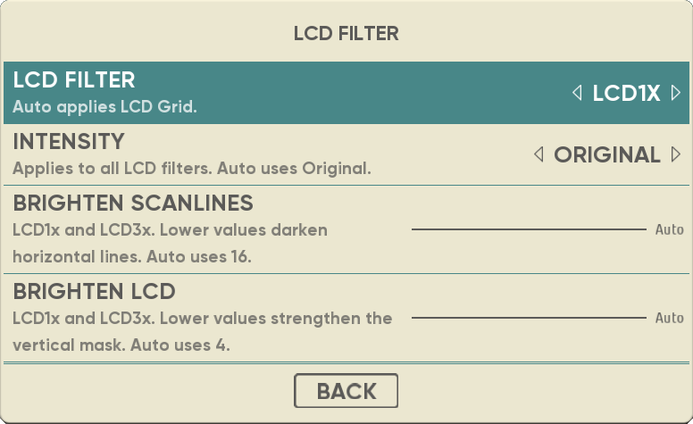
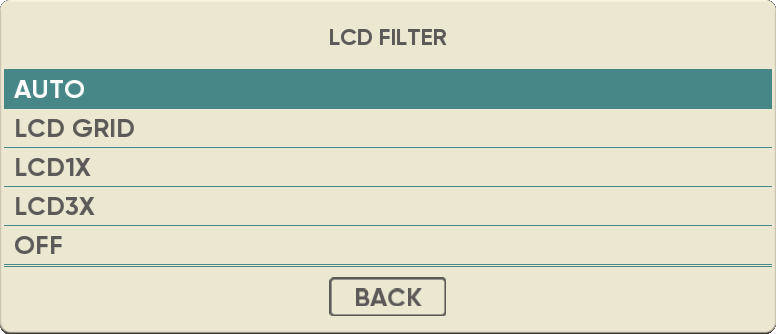
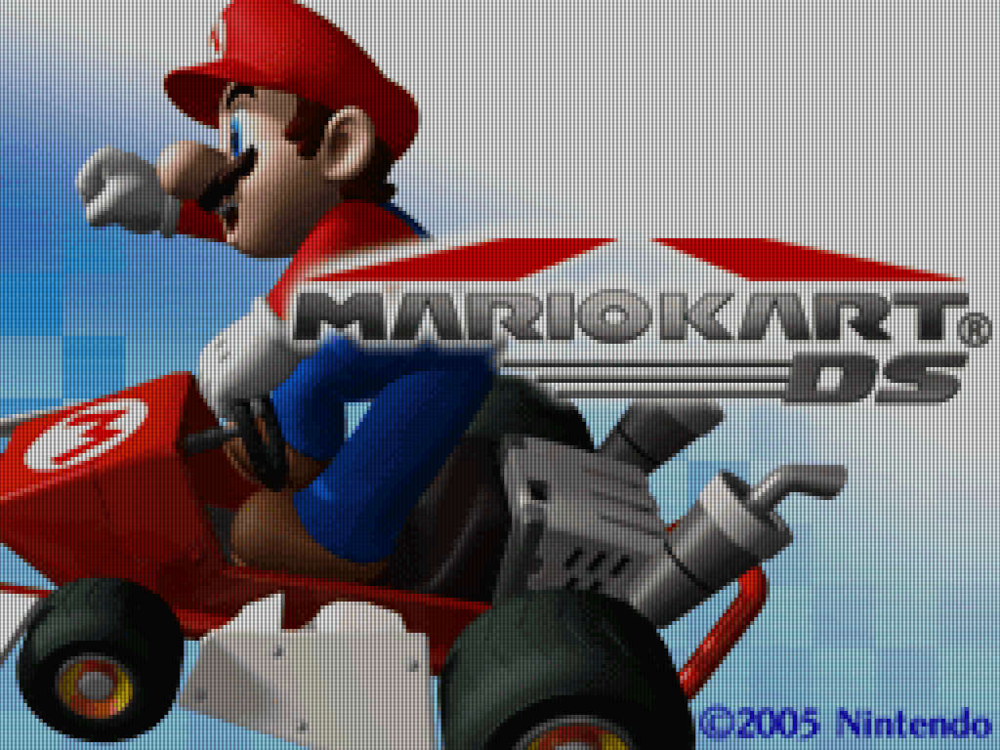
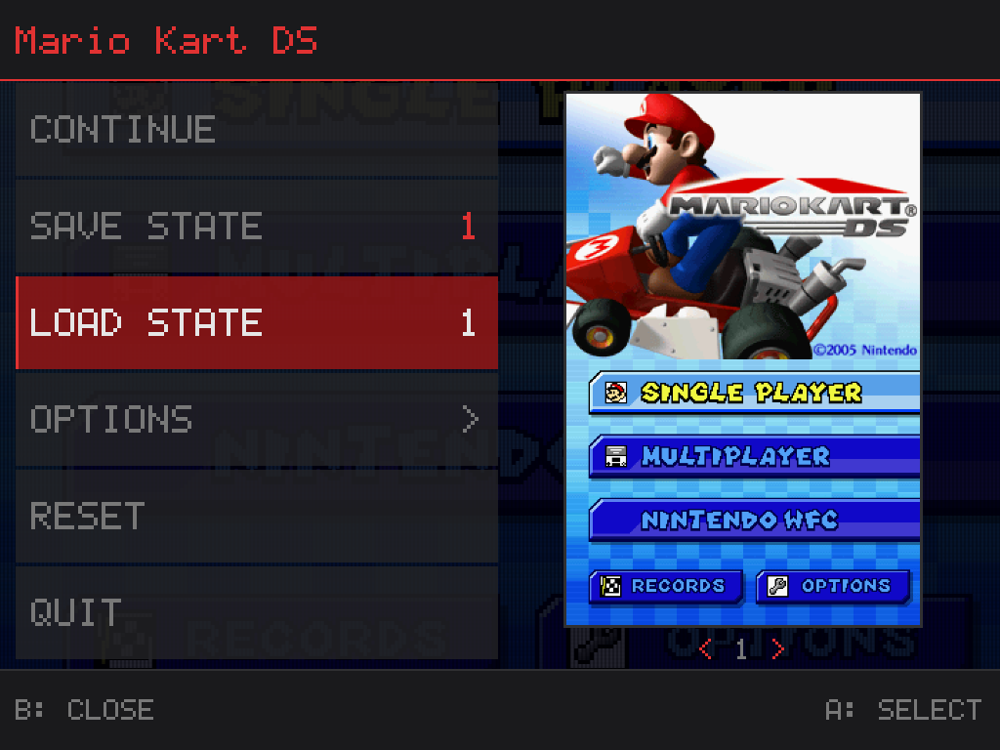

# DraStic UI Plus

Unofficial UI add-on for DraStic based on [Fun Drastic](https://github.com/Utility-Muffin-Research-Kitchen/Fun-Drastic-src) by tenlevels and contributors. This branch targets the Anbernic RG DS Plus running ROCKNIX.

DraStic UI Plus builds on the features already available in Fun Drastic. For the RG DS Plus, it adds dual-screen display and touch support, shared DraStic saves and save states, native fast-forward, adjustable LCD Grid, LCD1x, and LCD3x filters, and vertical save-state previews captured before LCD filtering.

The base import is Fun Drastic commit [7514876](https://github.com/Utility-Muffin-Research-Kitchen/Fun-Drastic-src/commit/75148764fd171f0f0e013fa3a13bedd9b9fb0991). See [LICENSE](LICENSE) and [CREDITS.md](CREDITS.md).

## Screenshots

### EmulationStation LCD filters





### DraStic UI Plus menu on RG DS Plus

#### Top Screen



#### Bottom Screen



## Build and package

```sh
make image
make rgdsplus
make pack-rgdsplus
```

The archive in `dist/` contains the UI library, scripts, EmulationStation configuration, and documentation. The launcher executes the compatible DraStic build at `/usr/config/drastic/drastic` and references the BIOS and emulator data already on the console. It checks the executable hash before loading the library because the integration depends on that build.

## Install on ROCKNIX

Close the running game before installation. Copy the archive to the console and extract it under `/storage` so the launcher is at `/storage/drastic-ui-plus/launch-rom.sh`. Install the archive's two `es_*.cfg` files in `/storage/.config/emulationstation/`, then restart EmulationStation. If the earlier Fun Drastic test integration is installed, move its `es_*_fun_drastic.cfg` files outside that directory first to avoid competing Nintendo DS overrides.

Choose **DraStic UI Plus** as the Nintendo DS emulator. The **LCD Filter** menu offers Auto, LCD Grid, LCD1x, LCD3x and Off. Auto applies LCD Grid. **Intensity** applies to all three filters, and **Brighten Scanlines** and **Brighten LCD** tune the horizontal and vertical masks in LCD1x and LCD3x. Reopen the game after changing settings.

The add-on uses its own `state/` folder for UI settings and preview images. In-game saves (`.dsv`) use `/storage/roms/nds/` by default. DraStic save states (`.dss`) use `/storage/roms/savestates/nds/`.

To use a custom location for in-game saves, close DraStic and run this optional command on the console with an existing writable directory:

```sh
/storage/drastic-ui-plus/set-save-directory.sh /path/to/saves
```

The script sets the `state/backup` symbolic link and preserves any existing save files. It replaces the default ROCKNIX link and asks you to handle any other existing path before switching. Use `state/savestates` to customize the state location independently. The launcher creates the default links on first use and preserves existing directories and links. When replacing a populated directory, back it up and copy any saves you want to keep into the new destination before switching. Existing saves stay in their original locations until you move them.
